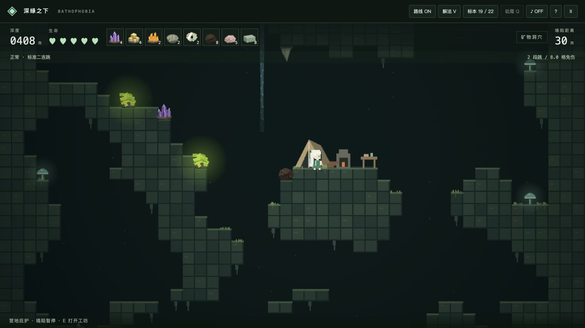
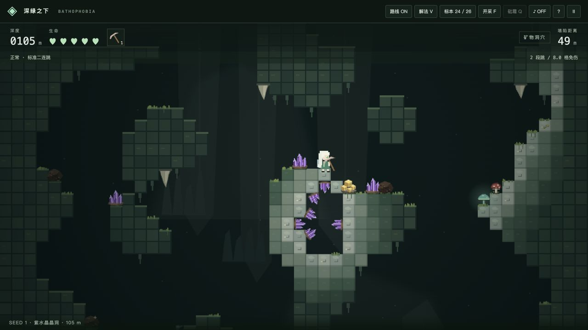
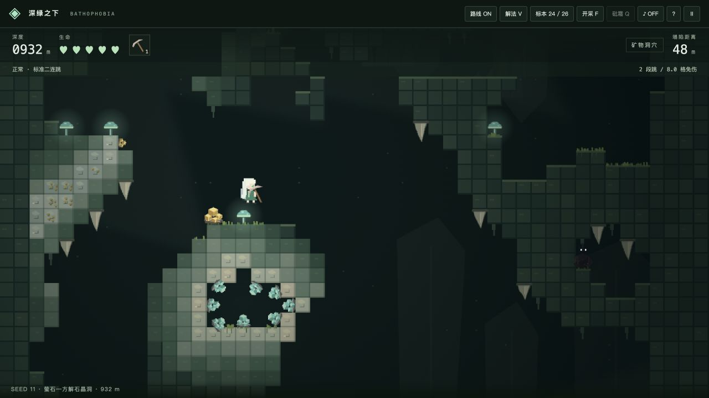
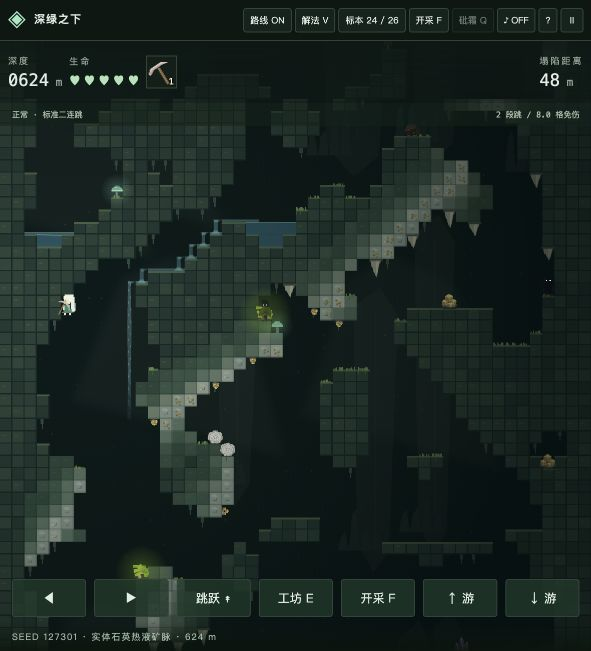
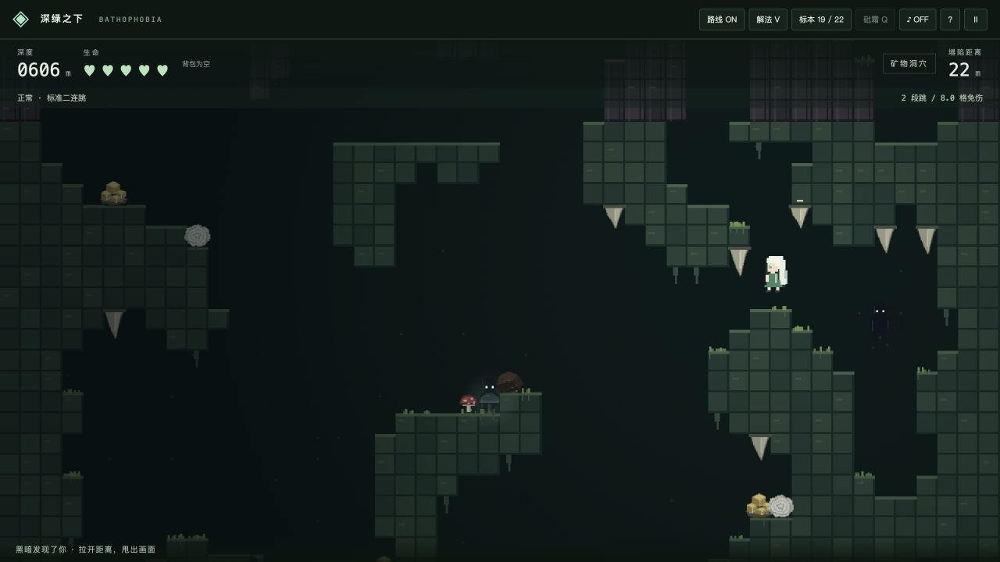
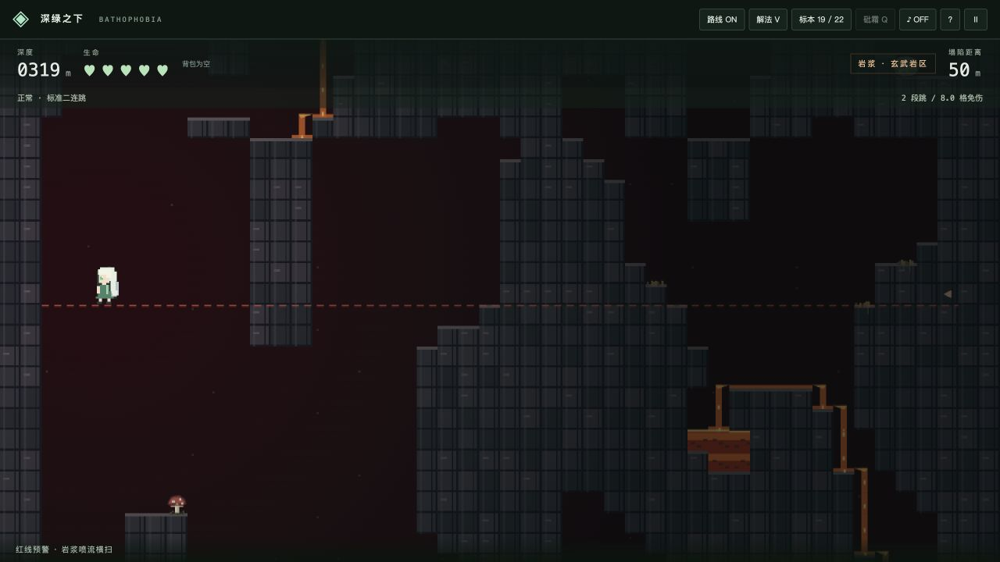
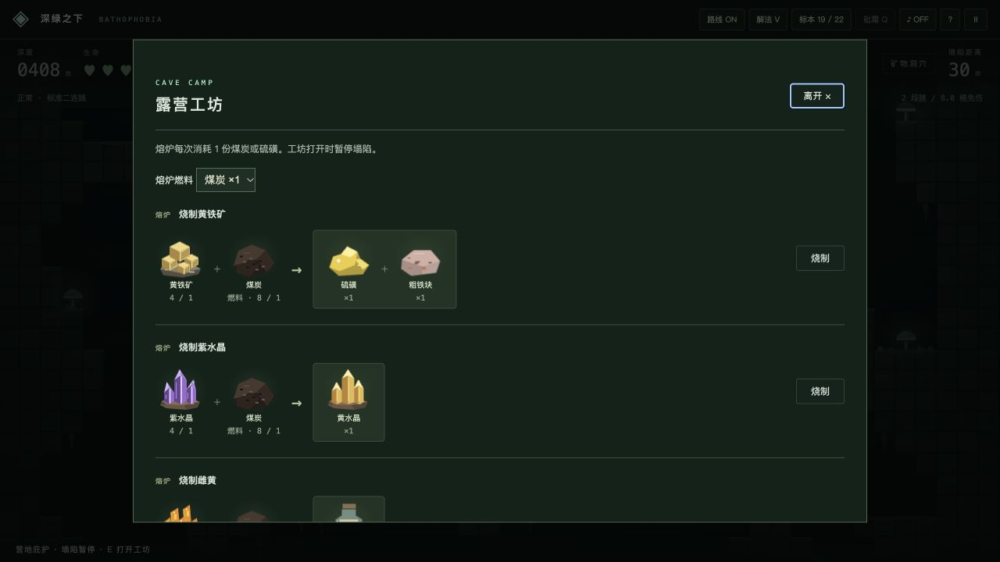
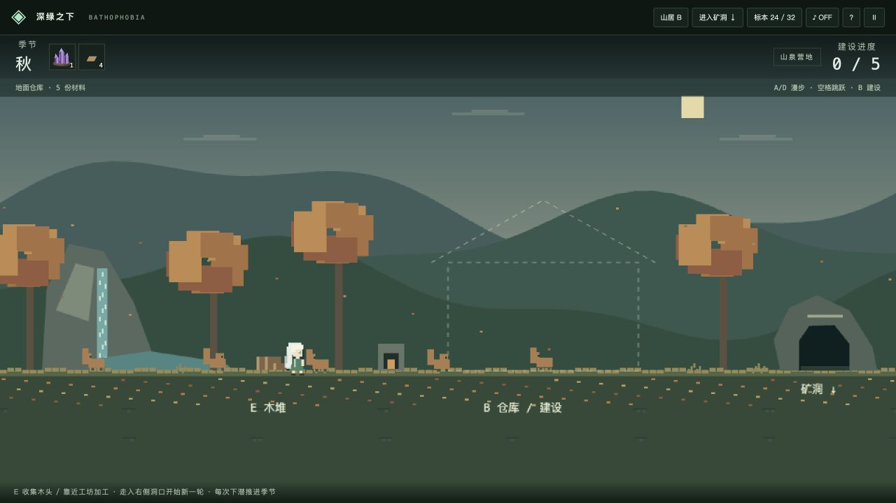
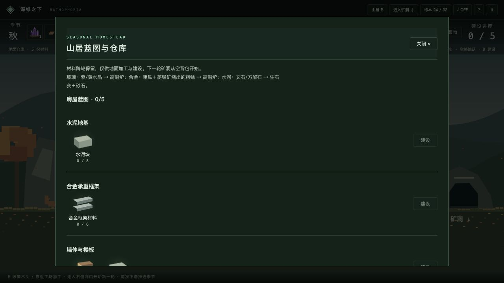

# 深绿之下 · Bathophobia

**带上矿物标本，向不断塌陷的地底深处前进。** 一个矿物学主题的无尽像素地牢，使用原生 JavaScript 与 Canvas 绘制。

**Collect minerals. Outrun the collapse. Descend into the unknown.** An endless, mineral-themed pixel dungeon built with vanilla JavaScript and Canvas.

[在线试玩 / Play](https://abyss.nero-lithos.com/) · [部署 / Deployment](DEPLOY.md)



## 玩法 / How to play

- **向下生存。** 左右移动、二连跳，利用水池、瀑布和荧光伞菇缓冲落差。塌陷会从上方追来；进入营地宽度内、上方三格高的庇护区可暂停塌陷。
- **采集与加工。** 接触矿物自动拾取，背包同类无限堆叠；采到后解锁图鉴。营地里烧制矿物、升级高温熔炉，制作拾取翻倍的收藏盒、粗铁镐和能救命一次的虹膜挂坠；挂坠复活后可自由飞行五秒，留下彩虹轨迹。
- **应对变化。** 红白蘑菇带来正负效果，最大生命在 3–7 之间。黑暗会跳跃追逐，石钟乳会坠落；约每 250 米进入一段约 100 米的玄武岩与岩浆区，留意横扫喷流的红线。

- **Keep descending.** Walk, double-jump, and soften falls with pools, waterfalls and glowing bounce mushrooms. The ceiling collapses behind you; the three-tile-high shelter above a camp's ledge pauses the collapse.
- **Collect and craft.** Touch minerals to collect them, stack your inventory, and reveal collection entries. Smelt minerals at camps, upgrade furnaces, and craft a collection box, an iron pickaxe or a one-use revival pendant, which grants five seconds of free flight with a rainbow trail.
- **Adapt to danger.** Mushrooms grant helpful or harmful effects, with maximum health bounded to 3–7. Shadows pursue you using real jumps; stalactites fall. Roughly every 250 m, a 100 m lava biome brings basalt columns and sweeping jets with red warning lines.

| 操作 / Action | 按键 / Keys |
| --- | --- |
| 行走 / Walk | A / D · ← / → |
| 跳跃 / Jump | Space · W · ↑ |
| 水池游泳 / Swim in pools | WASD / 方向键 · Arrow keys |
| 营地工坊 / Camp workshop | E |
| 开采 / Mine | F · F+W/S 朝上/下 / aim up/down · 点击近处岩石 / click nearby rock |
| 使用砒霜 / Use arsenic | Q · 点击背包药瓶 / Click the vial |
| 暂停、重开 / Pause, new run | P · R |
| 显示路线、解法演示 / Route overlay, solver replay | G · V |

触屏提供移动、跳跃、游泳与工坊按钮。砒霜最多持有一瓶，使用会降低一点最大生命，毒倒五格内黑暗。制作粗铁镐后，按 F 或点击近处岩石开采；嵌入矿石需要开采，外露晶体可直接拾取。

Touch controls support movement, jumping, swimming and the workshop. Carry one arsenic vial at a time; using it costs one maximum health and poisons shadows within five tiles. Craft a crude iron pickaxe, then hold F or click nearby rock to mine. Embedded deposits require mining; exposed crystals can be collected by contact.

## 晶洞与远景 / Geodes and depth

普通洞穴中的厚实岩体里藏有稀有的圆形 / 椭圆晶洞：围岩内包裹石英衬层和向心紫水晶，或灰白、局部浅黄的方解石衬层与青绿 / 蓝紫萤石。中央保留空气；封闭晶洞可被发现并用铁镐挖开。

Rare circular / elliptical geodes form in thick ordinary-cave rock: host rock encloses quartz and inward-growing amethyst, or pale calcite with teal / violet fluorite cubes. The center remains air. Sealed geodes can be discovered and opened with a pickaxe.

热液矿脉采用真正的不透明石英岩石 Tile，只替换既有固体岩石的材质；主体宽 1–2 格，局部至 3 格，连续噪声控制弯曲、变宽、方向和分叉。富矿段包含可开采的嵌入黄铁矿与可拾取的外露晶簇。

Hydrothermal lodes use opaque quartz rock tiles only inside existing solid rock. Their 1–2-tile cores swell locally to 3 tiles; continuous noise controls curvature, width, orientation and forks. Rich sections contain mineable embedded pyrite and collectible exposed crystals.

远景模糊洞穴轮廓以 **0.15×** 相机速度移动；中景岩柱、远处晶簇以 **0.4×** 移动；真实可碰撞前景为 **1×**。背景保持低对比度，无碰撞，不遮挡危险提示。

Distant blurred cave silhouettes move at **0.15×** camera speed; midground pillars and distant crystals at **0.4×**; solid foreground terrain at **1×**. Background layers remain subdued, non-colliding and behind all hazards.

### 晶洞与实体矿脉 · 三种种子 / Geodes and solid lodes · three seeds

| Seed 1 · 紫水晶 / Amethyst | Seed 11 · 萤石—方解石 / Fluorite–calcite | Seed 127301 · 石英矿脉 / Quartz lode |
| --- | --- | --- |
|  |  |  |

[生成器、数据结构、开采与验证 / Generator, data structures, mining and verification](docs/GEODES.md)

## 地底瞬间 / Underground moments

固定种子实机试玩截图，使用与正式游戏相同的生成器、物理和渲染。追逐场景展示影子的跳跃 AI；岩浆场景来自实际求解按键的物理回放。

Seeded in-engine playtest captures using the same generator, physics and rendering as the game. The chase shows the shadow's jumping AI; the lava scene is captured from a replay of solver-generated inputs.

| 黑暗追逐 / The chase | 玄武岩与岩浆喷流 / Basalt and lava jets |
| --- | --- |
|  |  |

<details>
<summary>图示合成工坊 / Visual crafting workshop</summary>

材料、燃料和产物直接显示为像素图片。材料下方为“持有 / 所需”，产物下方为单次获得数量。

Ingredients, fuel and results appear as pixel illustrations. Ingredient captions show owned / required counts; result captions show the output per craft.



</details>

## 技术与算法 / Technology and algorithms

- **天然洞穴：** 48×36 格区块、确定性种子噪声与四五细胞自动机平滑；BFS 洪泛填充检查连通性。岩浆区加入按列相干的噪声和竖向平滑，形成玄武岩台柱。晶洞通过岩岛连通分量和内接椭圆筛选，在通路求解前生成；石英矿脉只沿既有岩石生长。求解后不补平台，营地也只挑选天然 6–9 格干燥岩面。
- **通路验证：** A* 搜索离散物理动作图，以和实机相同的 60 Hz 重力、碰撞、跳跃与游泳逐帧回放。从上一块的精确出口继续，无伤、避开岩浆的候选才会被接受。
- **水与敌人：** 扫描线蓄水与重力溢流；瀑布超过八格后逐渐消散。影子使用局部 BFS 路点和短期动作预测，与玩家共享物理，不能穿墙。
- **前端：** 原生 HTML / CSS / Canvas，Web Worker 在前方生成并筛选区块，回收远处旧地图；首屏预载已验证地图，资源哈希处理缓存。零运行时依赖，无后端、数据库或 API Key。

- **Natural caves:** 48×36-tile chunks, deterministic seeded noise and the four–five cellular-automaton smoothing rule, followed by BFS flood-fill connectivity checks. Column-correlated noise and vertical smoothing shape basalt regions. Rock-component checks and inscribed ellipses place geodes before route solving; quartz veins follow existing rock. No platforms are patched in after solving; camps use natural dry ledges of 6–9 tiles.
- **Route validation:** A* searches a discrete physical action graph. Every accepted route retains exact inputs replayed at the same 60 Hz gravity, collision, jumping and swimming rules as live play, continuing from the previous chunk's exit state without damage or lava contact.
- **Water and enemies:** Scanline reservoirs and gravity-driven spillways produce pools and fading waterfalls. Shadows combine local BFS waypoints with short-horizon action prediction and obey player physics.
- **Frontend:** Vanilla HTML / CSS / Canvas with Web Worker generation ahead of the player, old-chunk disposal, certified boot maps and hashed assets. No runtime packages, backend, database or API keys.

路线保证针对已接受区块和离散动作图；偏离路线、长时间停留仍可能死亡。这不是对连续操作全局最优或数学意义无限地图的证明。水流是稳态模型，不是完整流体动力学。

Route validation applies to accepted chunks and the discrete action graph. Deviating or waiting can still kill you; it is not a proof of a globally optimal continuous path or a mathematically infinite map. Water uses a steady-state model rather than full fluid dynamics.

## 开发与部署 / Development and deployment

需要 Node.js 20+。无需安装第三方运行时依赖。 / Requires Node.js 20+. No third-party runtime dependencies.

```sh
npm ci
npm run dev       # http://localhost:5173
npm test
npm run build     # dist/
npm run preview   # http://localhost:4173
```

Cloudflare Pages：**Framework = None · Build = `npm run build` · Output = `dist`**。本地与生产均为标准静态前端。 / Both development and production use a standard static frontend. See [DEPLOY.md](DEPLOY.md).

## 后续目标 / Roadmap

- 更多硬矿、开采工具与加工链。 / More hard minerals, mining tools and processing chains.
- 返回地表，建造房屋与基地。 / Return to the surface and build a home or base.
- 玻璃建筑，以及文石 → 生石灰、砂石 → 水泥块等建材链。 / Glass construction and building-material chains such as aragonite → quicklime and aggregates → cement blocks.
- 更多地貌、危险、生物与探索内容。 / More biomes, hazards, creatures and exploration.

以上为计划，不是当前已实现功能。 / These are planned features, not current capabilities.


## 山居与四季 / Seasonal homestead (v0.11)

地面现为可游玩的山泉营地。A/D 漫步、空格跳跃，E 收集木堆或打开附近工坊，B 查看仓库和建房；走入右侧洞口开始下潜。每次下潜推进一个季节：春兔与燕、夏蛙与蝉鸣（打开声音）、秋枫与松鼠、冬雪与绵羊/企鹅。

暂停可以继续本轮，或返回地面结束本轮；死亡后可以重新下潜或返回地面。剩余背包材料自动入仓，仓库和蓝图进度保存在当前浏览器。**地面仓库不会补入下一轮洞穴背包**。中途刷新页面会把已保存的本轮剩余材料结算回地面，不能恢复该矿洞。

房屋按水泥地基 → 合金框架 → 墙体 → 木屋顶 → 玻璃窗建设，空中虚线提示位置。加工链：菱锰矿烧成粗锰，粗铁＋粗锰在高温炉中合金化；文石/方解石煅烧成生石灰，与开采所得砂石制水泥；紫/黄水晶在高温炉中熔制玻璃。所有配方是简化的游戏设计。地面熔炉升级独立持久化，烧制需煤炭或硫磺，每次下潜后地面木堆可收集一次。

粗铁镐可开采所有岩石，包括曾保护路线及水池的支撑块。剩余岩石不受重力；失去支撑的矿物、红白蘑菇和弹跳蘑菇会落到下一处岩面，跨分块转移。开采会使原无伤路线证书失效，后台会尝试重新验证本段；**自由开采后不再保证原路线安全**。

The playable surface features a mountain spring, a fixed dashed house blueprint, seasonal wildlife and a persistent warehouse. Walk with A/D, jump with Space, interact with E, and open construction/storage with B. Enter the right-hand cave mouth to start a fresh expedition; every descent advances the season. Enable sound to hear summer cicadas.

Pause to resume or finish the expedition and return home. Death allows a fresh run or a surface return. Remaining inventory is banked exactly once; **stored resources are never available during the next cave run**. Browser-local storage preserves the warehouse, furnace upgrade and building stages. Reloading settles the saved expedition inventory to the surface rather than restoring that cave.

Build foundation, alloy frame, walls, timber roof and glass windows in sequence. Smelt rhodochrosite into manganese, combine manganese and crude iron in the high furnace for structural alloy; calcine aragonite/calcite for quicklime and combine with mined aggregate for cement. Amethyst/citrine become glass in the high furnace. These are deliberately simplified game recipes.

Mining removes every rock type while remaining rock stays suspended. Unsupported collectible minerals and mushrooms fall with gravity and transfer across loaded chunks. Original A* certificates become invalid after excavation; a worker attempts local revalidation without blocking play. The surface animal controller shares seasonal wander/hop/fly behavior. Future work: editable floor plans, interiors, furniture and a richer surface ecology.



