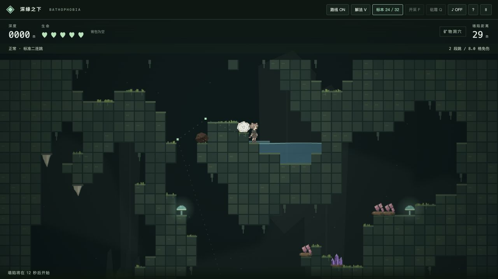
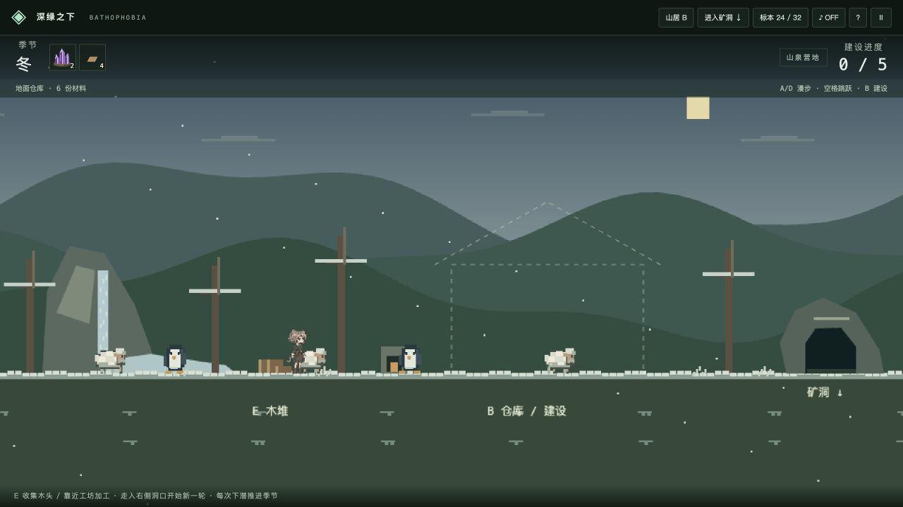

<div align="center">

# BATHOPHOBIA · 深绿之下

**采集矿物，逃离塌陷，回到四季山居。**<br>
**Collect minerals. Outrun the collapse. Build a home above.**


[**在线试玩 · Play now**](https://abyss.nero-lithos.com/) · [中文](#中文) · [English](#english) · [部署 · Deploy](DEPLOY.md)

</div>



| 四季山居 · Seasonal homestead | 地质探索 · Geological exploration |
| :---: | :---: |
|  |  |

## 中文

矿物学主题的无尽像素平台游戏。向下探索天然洞穴，采集标本、加工材料，躲避追来的塌陷；返回地表，用带回的资源建造房屋。

- **探索与生存**：二连跳、自由游泳、瀑布缓冲、弹跳蘑菇；影子追逐、坠落钟乳和岩浆喷流。
- **矿物与制作**：玛瑙、紫水晶、黄铁矿、萤石等标本；开采晶洞、烧制矿物、升级熔炉、制作装备与建材。
- **四季与建设**：每次下潜推进季节，地表拥有独立动画动物；按蓝图建造地基、合金框架、墙体、屋顶与玻璃窗。
- **跨轮进度**：仓库、图鉴和建设进度保存在浏览器；仓储材料不能带入下一轮洞穴背包。

## English

An endless, mineral-themed pixel platformer. Descend through natural caves, collect specimens, process materials and escape the collapsing ceiling. Bring resources home to build above ground.

- **Explore & survive** — Double-jump, swim, slow falls in waterfalls and bounce on mushrooms. Evade pursuing shadows, falling stalactites and lava jets.
- **Collect & craft** — Discover agate, amethyst, pyrite, fluorite and more. Mine geodes, smelt minerals, upgrade furnaces and craft equipment and building materials.
- **Seasons & building** — Every descent advances the season. Meet animated wildlife and complete a house blueprint, from foundation and alloy frame to glass windows.
- **Persistent progress** — Browser-local storage preserves your warehouse, collection and home. Stored materials stay out of your next expedition inventory.

## 操作 · Controls

| 操作 / Action | 按键 / Keys |
| --- | --- |
| 移动 / Move | A D / ← → |
| 跳跃 / Jump | Space / W / ↑ |
| 游泳 / Swim | WASD / Arrow keys |
| 交互、工坊 / Interact, workshop | E |
| 地表仓库与建设 / Surface storage & building | B |
| 开采 / Mine | F / 点击岩石 · Click rock；F + W/S 朝上/下 · aim up/down |
| 使用砒霜 / Use arsenic | Q |
| 暂停、重新下潜 / Pause, restart | P / R |
| 路线、解法回放 / Route, solver replay | G / V |

支持触屏按钮。采集剩余材料可在暂停或死亡后返回地表入仓。<br>
Touch controls included. Return home from pause or death to bank remaining materials.

## 技术与算法 · Under the hood

| 系统 / System | 实现 / Implementation |
| --- | --- |
| 前端 / Frontend | Vanilla JavaScript · HTML/CSS · Canvas 2D · Web Audio |
| 洞穴 / Caves | 确定性种子噪声、四五细胞自动机、BFS 洪泛填充 / Seeded noise, four–five cellular automata, BFS flood fill |
| 地质 / Geology | 椭圆距离场晶洞、相关噪声裂隙矿脉 / Elliptic geode fields, correlated-noise fracture veins |
| 路线 / Routes | A* 物理动作图、60 Hz 逐帧验证 / A* action graph, 60 Hz physics replay |
| 水体 / Water | 扫描线蓄水、重力溢流与瀑布 / Scanline pools, gravity spillways and waterfalls |
| 渲染 / Rendering | 像素图集、非均匀帧时长、视差背景 / Pixel atlases, nonuniform frame timing, parallax |
| 性能 / Performance | Web Worker 分块生成、旧区块回收、哈希资源 / Worker generation, chunk disposal, hashed assets |
| 存档 / Persistence | localStorage；无需后端 / No backend required |

路线验证针对生成时的地形；自由开采会使原路线失效并触发重新验证。<br>
Routes are validated against generated terrain; mining invalidates the original certificate and requests revalidation.

[地质生成文档 · Geology](docs/GEODES.md) · [山居系统 · Homestead](docs/HOMESTEAD.md)

## 本地运行 · Quick start

Node.js **20+**，无第三方运行时依赖。 / No third-party runtime dependencies.

```sh
git clone https://github.com/Nerolithos/Bathophobia.git
cd Bathophobia
npm ci
npm run dev       # http://localhost:5173
```

```sh
npm test          # Physics, generation, routes, crafting, persistence, wildlife
npm run build     # Static output: dist/
npm run preview   # http://localhost:4173
```

**Cloudflare Pages:** Framework `None` · Build `npm run build` · Output `dist`。详见 / See [DEPLOY.md](DEPLOY.md).

## 后续计划 · Roadmap

- [ ] 更自由的房屋布局、室内与家具 / Flexible house layouts, interiors and furniture
- [ ] 更多矿物、硬度与工具进阶 / More minerals, hardness and tool progression
- [ ] 更多洞穴生态与地貌 / More cave ecosystems and biomes

通过 Issues 提交问题或玩法建议；欢迎提交聚焦的小型 PR。<br>
Report bugs or ideas through Issues. Focused pull requests are welcome.
