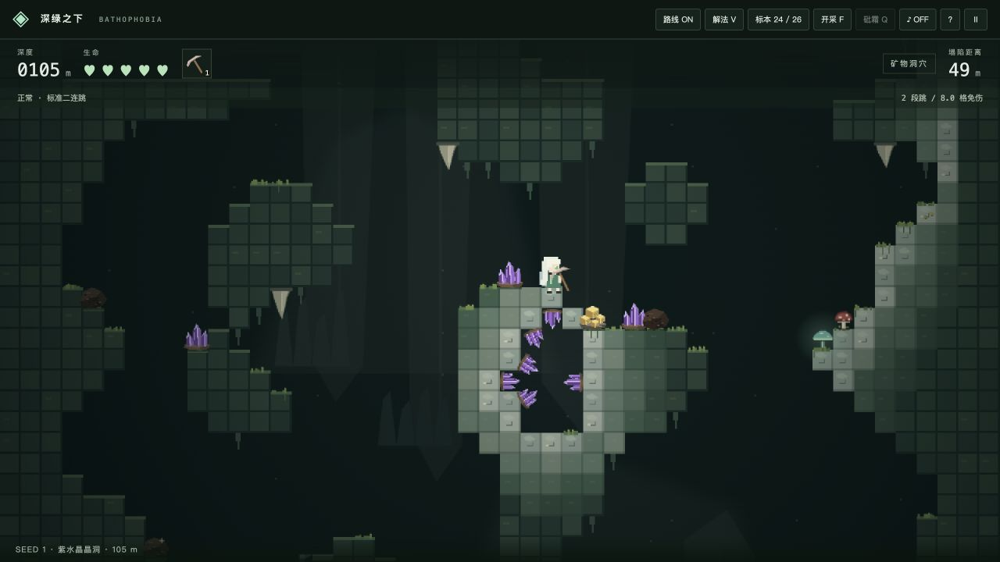
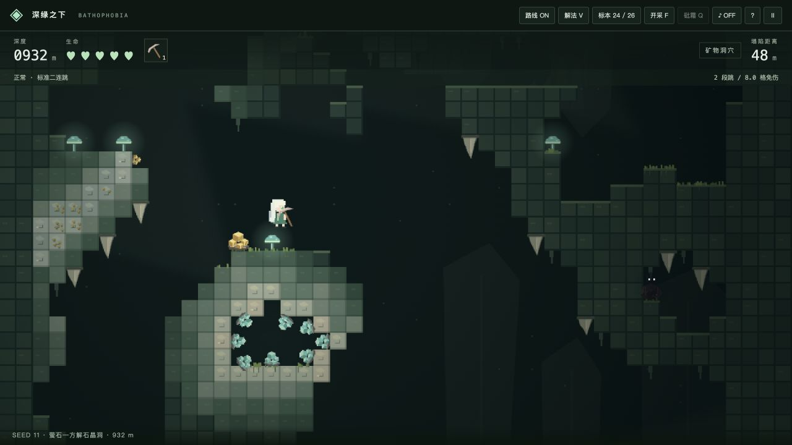
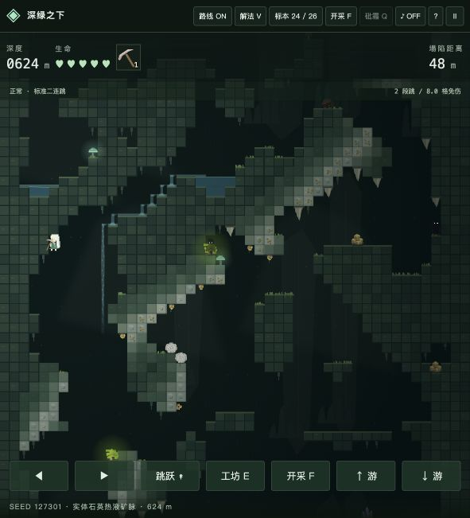
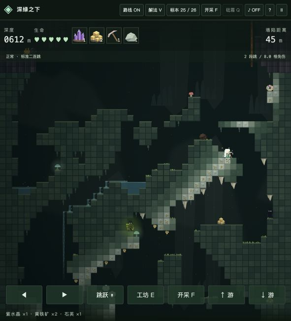

# 晶洞、实体石英矿脉与开采 / Geodes, solid quartz veins and mining

## 修改文件 / Changed files

| 文件 / File | 主要内容 / Change |
| --- | --- |
| [engine.js](../src/engine.js) | 可复用晶洞生成器、椭圆距离场、实体矿化、矿物附着、路线验证、铁镐开采 |
| [game.js](../src/game.js) | F / 鼠标 / 触屏开采、发现提示、真实背包与图鉴产出、开采裂纹 |
| [visuals.js](../src/visuals.js) | 不透明石英和方解石 Tile、变大小向心晶体、矿物资料、方解石与石英标本 |
| [systems.js](../src/systems.js) | 在旧物品 ID 后追加方解石、石英，扩充背包容量 |
| [threats.js](../src/threats.js) | 晶洞范围避让影子和石钟乳 |
| [index.html](../index.html)、[style.css](../style.css) | 操作说明、开采按钮及图鉴资料样式 |
| [verify-geology.cjs](../verify-geology.cjs)、[verify-geodes-mining.cjs](../verify-geodes-mining.cjs) | 地形、晶洞、边界、开采、证书、背包和持久化回归 |
| README、本文、screenshots/、package.json / package-lock.json | 双语说明、三种种子截图、版本 0.11.0 与测试命令 |

## 数据结构 / Data structures

```js
Segment = {
  tiles,                 // 36 × 48 collision grid: 0 air, 1 solid
  materials,             // 0 host, 1 quartz, 2 calcite, 3/5/6 alteration
  hydro, gradeMap,        // core mask and correlated enrichment
  geodes: [Geode],
  ores: [Ore],
  routeGuard,            // solids supporting the replayed certificate / seam
  miningDamage: {}       // "tx,ty" -> accumulated hits, for this run
}
Geode = {
  id, owner,             // unique seeded ID and owning chunk
  cx, cy, rx, ry, phase,  // world-tile center, radii, boundary perturbation
  kind,                  // 'amethyst' | 'fluorite'
  variant, color,        // 'purple' | 'teal' | 'violet', existing item ID
  lining, cavity,        // arrays of [worldTileX, worldTileY]
  open, sealed, discovered
}
Ore = {
  id, type, variant,
  tx, ty, x, y,
  presentation,          // embedded | wall | cluster
  mineOnly, yield,        // embedded resource gate and actual output
  nx, ny, rotation, scale,// rock-supported, inward crystal growth
  pickBounds, geodeId
}
```

为兼容已有图鉴，青绿 / 蓝紫萤石保留 **22 / 23** 两个旧 ID，并记录 `variant`；新增 **24 方解石、25 石英**。背包和图鉴沿用原入口。化学资料：萤石 CaF₂、莫氏硬度 4、等轴晶系及常见热液 / 方解石共生，见 [Handbook of Mineralogy](https://www.handbookofmineralogy.org/pdfs/fluorite.pdf)；方解石 CaCO₃、硬度 3，见 [矿物手册](https://handbookofmineralogy.org/wp-content/uploads/2022/07/calcite.pdf)，三方晶系见 [MSA 矿物鉴定表](https://msaweb.org/msa/Collectors_Corner/id/mineral_id_keytiid1.htm)。石英 SiO₂、硬度 7、三方晶体结构见 [剑桥大学矿物藏品](https://p1acollections.esc.cam.ac.uk/p1acollections/exhibits/show/minerals/quartz.html)。

Existing fluorite IDs 22 / 23 remain compatible and also carry a variant. Calcite and quartz append as IDs 24 / 25. Inventory stacking and persisted discoveries use the existing collection entry points.

## Geode Generator

`generateGeodes(tiles, { seed, id, attempt, origin, water, occupied })` 可复用在已有实体网格上。

1. 在细胞自动机地形中 BFS 识别连续岩体，筛选面积、厚度和中心候选。
2. 种子确定 4–6 格半径、近圆 / 椭圆形状及连续角向微扰。紫水晶类型概率 65%，萤石类型 35%；普通区域每段最多一个，只有岩体满足条件时才生成。
3. 候选椭圆要求足够高的岩石占比，排除预览水体、岩浆和占用区域。中央只挖出有限空气腔，不向原有空气填岩石。
4. 保留最外层围岩，内侧一格变为石英或方解石衬层，晶体沿实际内壁、向中心生长。每组大小不同，中央保持空余。
5. 整个椭圆必须位于一个拥有者区块内，并避开接缝缓冲区。跨界候选跳过，而不是裁切或在下一块重复生成。
6. 用空气 BFS 判断真正封闭或局部暴露状态。营地、危险物布局在后续阶段避开晶洞；重新执行 BFS 和 A*，只接受有证书的区块。

The reusable generator selects thick connected rock, uses seeded perturbed elliptical distance fields, retains host rock and a mineral lining, and carves only the central cavity. Complete chunk ownership avoids clipped or duplicated geodes. Water / occupied regions are excluded, and normal route validation follows all terrain edits.

## 实体热液矿脉 / Solid hydrothermal lodes

连续噪声定义区域裂隙方向、弯曲、宽度和富贫段，少量分支从主脉起始。方向在不同区域和种子间变化。矿化只是原有固体 Tile 的材质替换，不填空气、水和通道；石英底色不透明，已经删除贯穿 Tile 的半透明白线绘制。

主体宽 1–2 Tile、局部不超过 3 Tile。富矿段提高嵌入黄铁矿的数量和产出，也保留一定数量的外露晶簇；嵌入矿石不是纯背景纹理。

Correlated fracture fields vary orientation, curvature, width and grade. Quartz is an opaque material on pre-existing solids; it cannot bridge air gaps. Enriched stretches produce actual mineable ore and exposed collectible specimens.

## 开采与封闭晶洞 / Mining and sealed geodes

- 营地制作粗铁镐后，F / F+W/S / 鼠标开采所有岩石。所有剩余石块保持悬空，不受重力影响。
- 移除支撑后，外露矿物、蘑菇和完全失去支撑的营地物件落向下层岩面；嵌入矿物直接掉入背包，不重复产出。
- 水场随碰撞更新。原路线保护标记不再阻止开采；修改后的路线证书失效，Worker 尝试重新求解，不能沿用开采前的安全承诺。
- 背包在死亡、返地面、刷新时结算到地面独立仓库，下一轮背包清空；图鉴与建筑进度持久化。

Mining now removes any rock, including route and water support. Rock does not fall; unsupported collectibles and camp props do. Editing invalidates the original certificate and requests worker-side revalidation. Remaining inventory is banked to isolated surface storage and never restored into the next expedition.

## 验证结果 / Verification

- 同种子、尝试号和区块输入的晶洞、矿脉及附着结果一致。
- 检查实体变化只位于晶洞中央腔体，矿脉不填空气；跨区块裂隙保持连续，晶洞不跨拥有者边界。
- 108 块连续地形逐帧零伤害回放、组合世界回放、敌人 / 水流 / 营地 / 合成 / 快速启动回归通过。
- 合成测试网格实际挖开封闭晶洞，验证开采距离、遮挡、产出、防重复和支撑移除。
- 在不接触原路线支撑的测试点开采，原证书仍可回放；任意开采后必须重新求解，不能假设旧证书有效。
- 实际 `gainItem` / localStorage 入口验证两色萤石、方解石与石英进入背包和图鉴，并在重新加载后保持发现记录。
- 实机鼠标开采验证三次敲击获得黄铁矿和石英等物品。

Run `npm test` and `npm run build`. Tests cover deterministic geodes, controlled collision edits, seam ownership, reusable generation conflicts, sealed-shell excavation, pickup and resource depletion, route replay after mining, and real inventory / collection persistence.

## 三种种子的实机截图 / Three seeded captures

以下为固定种子实机验证场景，晶洞和矿脉均由正式生成器产生，人物初始位置取自真实路线回放。演示场景预置粗铁镐；没有手工放置晶洞或修改截图。

These in-engine validation scenes use the production generator and replayed player states. A pickaxe is supplied for the mining demonstration; geodes are not hand-placed and the screenshots are not retouched.

### Seed 1 · 紫水晶晶洞 / Amethyst · 105 m



### Seed 11 · 萤石—方解石晶洞 / Fluorite–calcite · 932 m



### Seed 127301 · 实体热液矿脉 / Solid hydrothermal lode · 624 m



### 实际开采产出 / Mining output


