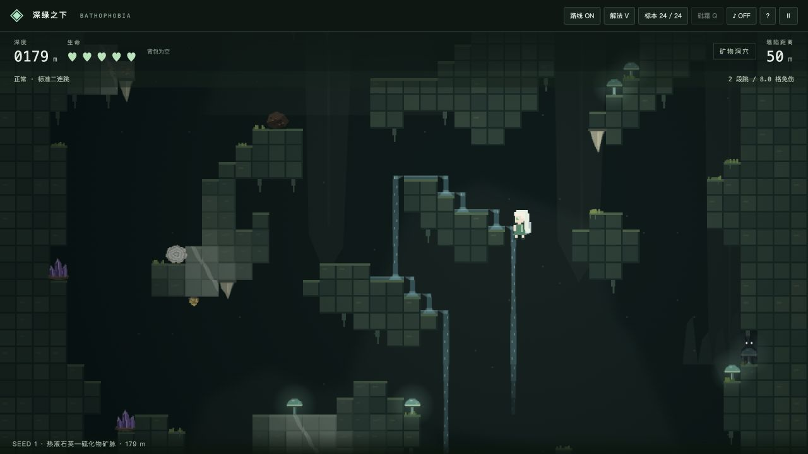
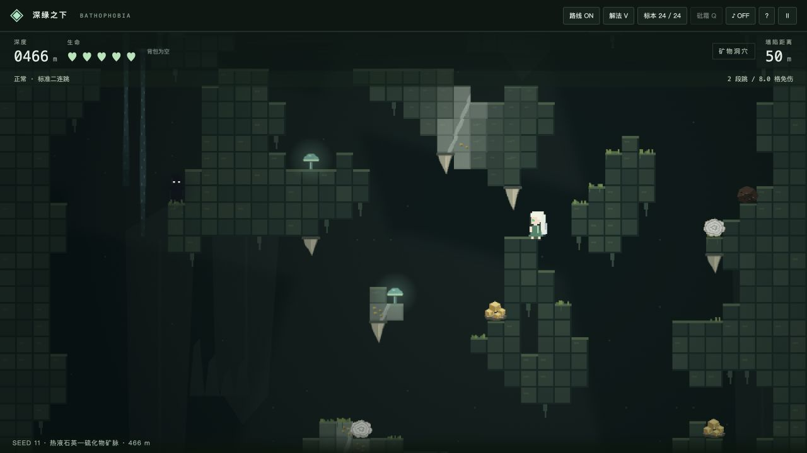
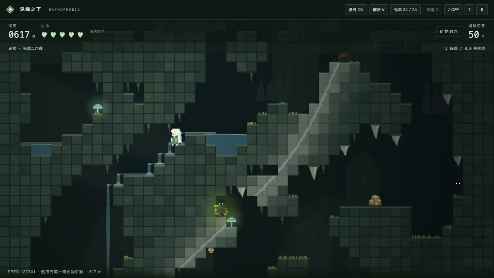

# 热液石英—硫化物矿脉 / Hydrothermal quartz–sulphide veins

本轮仅调整矿化生成、矿物表现和采集碰触范围；细胞自动机、重力碰撞、BFS 和 A* 求解器保持原实现。

This update changes mineralization, mineral presentation and contact pickup bounds. Cellular terrain, collision physics, BFS and A* retain their existing implementation.

## 修改文件 / Changed files

| 文件 / File | 内容 / Change |
| --- | --- |
| [engine.js](../src/engine.js) | 独立连续裂隙、变宽与分叉、蚀变、矿斑、稀有空腔、壁面附着和采集范围 / Fractures, alteration, inclusions, rare pockets, attachments and pickup bounds |
| [visuals.js](../src/visuals.js) | 低饱和石英细纹、保留围岩纹理、嵌入矿斑、四向壁晶、弱晶洞光照 / Subdued quartz, host texture, embedded grains, oriented wall crystals and restrained pocket lighting |
| [game.js](../src/game.js) | 新绘制层及接触采集接口 / Render integration and contact pickup |
| [verify-geology.cjs](../verify-geology.cjs) | 原地形指纹、确定性、跨块连续、宽度、附着、间距、采集与序列化 / Geometry fingerprints and geological / pickup regression checks |
| [verify.cjs](../verify.cjs) | 区分地表矿物与有支撑的壁面矿物 / Distinguish ground specimens from wall attachments |
| [README.md](../README.md)、本页、screenshots/ | 双语说明与三个种子的实机截图 / Bilingual notes and three seeded playtest captures |
| package.json、package-lock.json | 0.9.1 版本标记 / Version 0.9.1 |

## 关键算法 / Key algorithms

1. **先裂隙，后求交。** 裂隙由世界深度和种子定义，不读取平台位置。低频平滑值噪声控制弯曲、宽度和矿化品位；主脉多数宽 1–2 Tile，局部膨大但不超过 4 Tile。少量分叉从主脉上的真实点起始。世界坐标采样使同一裂隙跨区块延续。
2. **只矿化已有岩石。** 将折线路径投影到格点、计算最近距离，再与既有实体网格求交。空气保留为空气，空腔两侧能看到同一条裂隙的延续。未改变旧版晶洞的碰撞网格，也未为矿脉补平台、挖通路。
3. **分级蚀变。** 脉体外约 1–3 Tile 内依次使用硅化、强蚀变和弱蚀变材质；低透明度底色保留原围岩纹理。石英只绘少量细纹，亮度低于金属反光和稀有晶体。
4. **富贫分段。** 平滑品位场划分贫矿、普通和富矿段。贫矿几乎没有矿物；富矿的黄铁矿以脉内细粒和浸染斑为主。没有均匀铺满平台顶部的额外金色晶簇。
5. **三种表现。** 嵌入矿斑位于实体 Tile 内；少量壁晶有明确支撑格、朝向空气；完整晶簇最多三组，集中于稀有晶洞。露出的矿斑和壁晶使用贴近开放一侧的采集范围，附着点之间保持至少 27 px 间距。
6. **复用空腔。** 在富矿裂隙与天然空气接触处筛选少量局部晶洞，不新增挖洞操作。旧的小晶洞不再统一铺白、填满发光水晶；仅少数特殊晶洞保留完整晶体表现。

Fractures are globally seeded, smoothly correlated polylines independent of platforms. Distance-to-path sampling controls narrow variable-width cores, forks, alteration and coherent ore grades. Only existing solid tiles receive mineralization. Wall specimens have real rock support and face adjacent air; rare pockets reuse existing voids. Their geometry does not alter collision or route validation.

## 采集与存储 / Collection and persistence

当前采矿入口是接触采集。内部未露出的矿斑是矿化纹理，开放壁面的矿斑和晶体可接触拾取；铁镐挖掘留待后续。黄铁矿、紫水晶、两色萤石沿用原物品 ID，不改变配方和背包堆叠。

Existing contact pickup remains the collection mechanism. Buried grains are texture; exposed deposits and wall crystals can be collected. Mining with the pickaxe remains future work. Existing mineral IDs, recipes and inventory stacking remain compatible.

图鉴发现记录和最高深度继续使用原 localStorage 键与数据格式。新增矿物表现、附着和采集范围可随现有启动缓存一起 JSON 序列化。

Collection discoveries and best depth keep the same localStorage keys and format. Presentation, support and pickup-bound metadata survive the JSON serialization used by boot caches.

## 验证 / Verification

- 12 组优化前的实体网格 SHA-256 指纹一致：没有填空气、改变平台或改动原碰撞结构。
- 108 组种子 / 深度样本检查确定性、裂隙连接、跨块接缝、宽度和分叉起点。
- 108 块连续物理回放，每个种子验证 1296 m，沿用原零伤害 / 避岩浆证书。
- 四向壁面均有实际支撑，附着间距、接触采集、稀有晶洞和 JSON 往返验证通过。
- `npm test` 覆盖水流、摔伤、敌人、营地、合成、复活和快速启动；`npm run build` 验证生产产物。

Tests compare pre-update collision fingerprints, check deterministic fractures and chunk seams, replay certified routes, validate support / spacing / pickup, and round-trip mineral metadata. Route validation covers accepted chunks and the existing discrete action graph; it does not promise survival after arbitrary player actions.

## 三种种子的实机截图 / Three seeded in-engine captures

截图来自同一套生成器和渲染器，以真实求解按键回放取得人物状态；未手工摆放矿脉、修改照片或补造岩石。每张图底部标出种子和深度。

These captures use the game generator and renderer with player states from real input replays. No veins were hand-placed, no screenshots were retouched, and no rock was added for the pictures.

### Seed 1 · 179 m

### Seed 11 · 466 m

### Seed 127301 · 617 m

