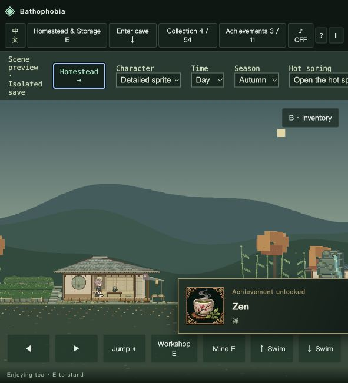
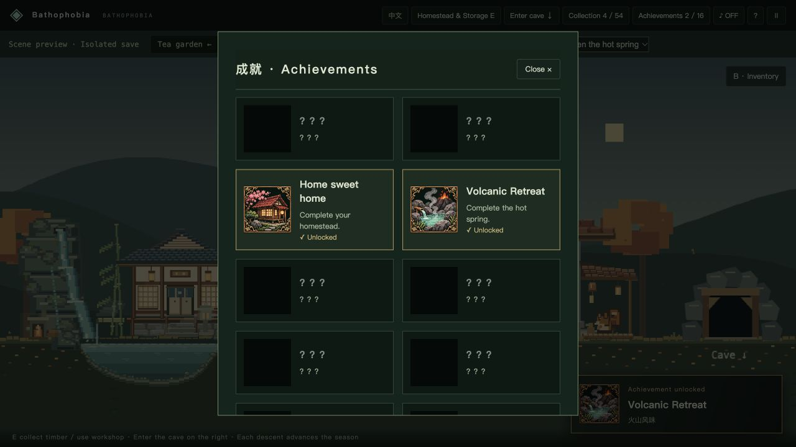

# Achievements / 成就

Sixteen persistent achievements, unlocked by gameplay events. The five cumulative achievements listed below extend the original eleven. The button beside Collection opens the gallery; unlocked badges are highlighted and locked names/conditions are `？？？`. A five-second notification appears at the bottom right; simultaneous unlocks queue instead of overlapping. Names, conditions and notifications follow the language setting.

| 成就 | English | 条件 / Trigger |
|---|---|---|
| 地质发烧友 | Mineral nerd | Collect morganite, demantoid, wulfenite and cuprian adamite / 摩根石、翠榴石、钼铅矿、铜水砷锌矿 |
| 禅 | Zen | First tea sitting after both the eight-stage tea house and tea field are completed |
| 温馨的家 | Home sweet home | Complete the homestead |
| 火山风味 | Volcanic Retreat | Complete the hot spring |
| 惊险逃生 | Narrow escape | A shadow tracked chasing you on one heart disappears off-screen while you remain alive on one heart |
| 慌不择路 | Panic attack | Fatal fall while chased; a successful Iris revival does not count |
| 夜猫子 | Not tired yet | Attempt to use the bed at night and be denied |
| 高空抛物 | Mind your head | Take damage from a falling stalactite |
| 小心地滑 | Oopsie! | Slip outdoors in spring or summer |
| 落地水 | Water MLG | Enter non-lava pooled water after falling more than 8 tiles, descending and taking no damage |
| 好渴！ | Quite thirsty! | Enter the gossan oxidation biome |

`src/achievements.js` stores unlocked IDs and timestamps under `bathophobia-achievements-v1`. Duplicate events never enqueue another notification. Broken or unavailable browser storage is tolerated. Existing discovered minerals and completed homes/springs are reconciled; event-only achievements require the actual action. Chasing state resets each expedition. Route demos do not unlock cave achievements. The full-build admin page uses its existing isolated storage.

`src/achievement-ui.js` renders the gallery and notification queue. All new assets and scripts are included in the versioned Cloudflare Pages bundle. The art was generated with built-in imagegen and packed into an equal-cell atlas; the original sheet, prompt specification and packed badges are in `assets/achievements/`. The combined atlas has sixteen ornate square badges. The original eleven images are preserved; the original spare compass tile is no longer used.

Validation: `npm test`, `npm run build`; unit positive/negative cases for all 11 achievements, save/reload/corrupt storage, duplicate prevention, real shadow offscreen provenance and real engine long-fall water entry; browser verification of Zen, queued notices, bilingual gallery, highlighted unlocks and hidden locked identities.

## Five cumulative achievements

| 成就 | English | Trigger |
|---|---|---|
| 愚人金 | These ain't gold | Gather at least 10 pyrite and 10 chalcopyrite across expeditions |
| 炉火纯青 | Trial by Fire | Upgrade a high furnace and complete a recipe marked high-temperature-only |
| 万物皆有理 | It’s All Science | Discover all 54 current collectible material/item IDs and unlock all current canonical processing recipes |
| 猫有九条命 | Cats have nine lives | Die in nine cave expeditions; repeated death callbacks from the same run do not count |
| 物法双修 | Physics vs. Chemistry | Completely break one or more blocks by pickaxe and one or more by HF; either order, no time limit, across sessions |

Recipe discovery records knowledge rather than requiring every recipe to be performed: all fixed ingredients and catalysts must be discovered, at least one option from each alternative group must be known, and high-temperature or interior requirements must be unlocked. This does not hide or alter the existing processing interface. Architectural wind chime ID 47 remains excluded from collectible materials. Current holdings and previously found specimens supply a safe migration baseline; historical deaths and mining actions without records are never invented.

The achievement storage key remains unchanged; its payload is upgraded to version 2 while preserving original unlock timestamps. It now also stores collection totals, discovered materials/recipes, furnace/high-processing milestones, expedition death count and the two mining-method flags. Ordinary furnace recipes cooked in a high furnace do not satisfy Trial by Fire. Failed crafting and incomplete/failed mining actions do not count. Iris resurrection is not a death.

Art: built-in imagegen, referenced to the original badge source, with the same bronze/gold square filigree and deep green background. New source and prompt are `assets/achievements/extension-source.png` and `extension-prompt.md`; `badges.png` is a 4×4 atlas. Tests cover cumulative reload/reset, migration, incomplete thresholds, duplicate death callbacks, recipe knowledge and corrected English labels.

