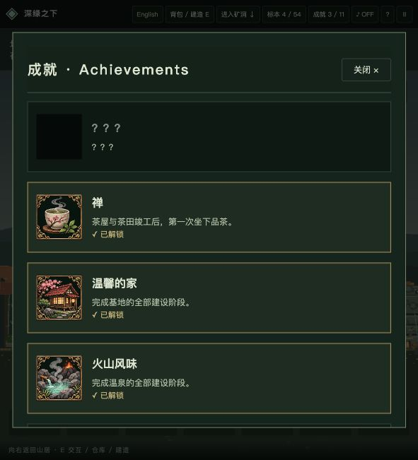

# Achievements / 成就

Eleven persistent achievements, unlocked by gameplay events. No additional achievements were added in this version. The button beside Collection opens the gallery; unlocked badges are highlighted and locked names/conditions are `？？？`. A five-second notification appears at the bottom right; simultaneous unlocks queue instead of overlapping. Names, conditions and notifications follow the language setting.

| 成就 | English | 条件 / Trigger |
|---|---|---|
| 地质发烧友 | Mineral nerd | Collect morganite, demantoid, wulfenite and cuprian adamite / 摩根石、翠榴石、钼铅矿、铜水砷锌矿 |
| 禅 | Zen | First tea sitting after both the eight-stage tea house and tea field are completed |
| 温馨的家 | Home sweet home | Complete the homestead |
| 火山风味 | Vulcanic retreat | Complete the hot spring |
| 惊险逃生 | Narrow escape | A shadow tracked chasing you on one heart disappears off-screen while you remain alive on one heart |
| 慌不择路 | Panic attack | Fatal fall while chased; a successful Iris revival does not count |
| 夜猫子 | Not tired yet | Attempt to use the bed at night and be denied |
| 高空抛物 | Mind your head | Take damage from a falling stalactite |
| 小心地滑 | Oopsey | Slip outdoors in spring or summer |
| 落地水 | Water MLG | Enter non-lava pooled water after falling more than 8 tiles, descending and taking no damage |
| 好渴！ | Quite thirsty! | Enter the gossan oxidation biome |

`src/achievements.js` stores unlocked IDs and timestamps under `bathophobia-achievements-v1`. Duplicate events never enqueue another notification. Broken or unavailable browser storage is tolerated. Existing discovered minerals and completed homes/springs are reconciled; event-only achievements require the actual action. Chasing state resets each expedition. Route demos do not unlock cave achievements. The full-build admin page uses its existing isolated storage.

`src/achievement-ui.js` renders the gallery and notification queue. All new assets and scripts are included in the versioned Cloudflare Pages bundle. The art was generated with built-in imagegen and packed into an equal-cell atlas; the original sheet, prompt specification and packed badges are in `assets/achievements/`. Eleven ornate square badges are used; the twelfth compass tile is unused artwork, not an extra achievement.

Validation: `npm test`, `npm run build`; unit positive/negative cases for all 11 achievements, save/reload/corrupt storage, duplicate prevention, real shadow offscreen provenance and real engine long-fall water entry; browser verification of Zen, queued notices, bilingual gallery, highlighted unlocks and hidden locked identities.

