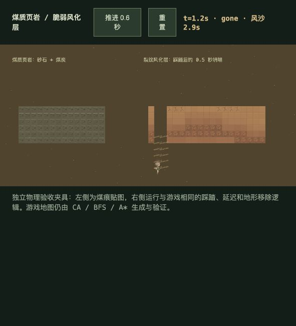

# Fuel, coal shale and fragile ground

- Timber is an alternative heating fuel. Pyrite, chalcopyrite, manganese and alloy reduction reject timber; existing coal requirements remain in force.
- Ordinary caves have slightly fewer surface amethysts and more coal. Seeded elliptical coal-shale lenses only change existing ordinary rock material. Their dark surface flecks identify blocks yielding one aggregate and one coal when mined.
- Gossan clay surfaces can contain seeded cracked groups spanning 2–4 nearby columns. Standing on a cap starts a 0.5-second timer. The complete unsupported columns drop, disintegrate into sand and produce 3.6 seconds of fading windblown dust.
- Generation excludes certified route supports, chunk seams and camps. Runtime rechecks route guards before removing tiles; edits invalidate the route and request the existing worker validation. Interactive objects use the existing falling-support system.

Validation: `npm test`, `npm run build`. Regression coverage includes fuel costs/rejection, deterministic shale and fracture generation, aggregate + coal yield, delay, whole-column removal, one-shot triggering, route-guard veto, and multi-seed certified descent replay with active hazards.

The screenshot below is an isolated physics/art fixture using the shared engine and tile renderer, not a randomly generated gameplay map. Open `/assets/mineral-studies/fragile-ground-preview.html` to advance its simulation.

