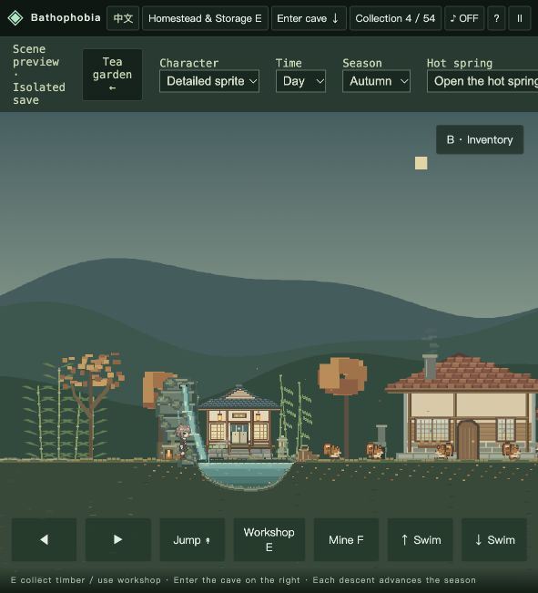

# Surface camera and scene transitions

The tea garden occupies world x −960…0, with the homestead at 0…960. Local physics and interaction coordinates remain unchanged. Crossing the boundary preserves world position. An exponential camera follow (4/s) eases towards the player with bounded scrolling. Distant hills use 0.15/0.28/0.4 scroll factors; the onsen inn and bamboo use 0.82. Buildings, terrain and collision stay at 1.0.

Both room clips are restored before the actor is drawn once in world space. This prevents half-body clipping at the seam, including ears and tails. Ground heights and base colors match at the boundary. The former ground navigation text and wooden sign are removed.

Confirmed cave departure and the return button use the existing 3.6-second pixel edge-in sleep mask. The scene changes once at 1.65 seconds, under full cover; simulation and keys are suspended during the transition. Cancelling the kit selection does not start it.

Reference: Phaser camera follow/lerp and scroll factors: https://docs.phaser.io/phaser/concepts/cameras

Validation: full `npm test`, `npm run build`, browser cave departure/return, and walking through the surface boundary. Regression tests check camera bounds, continuous coordinates, unclipped single actor draw, 0.82× backdrop translation and one-time masked scene switching.

