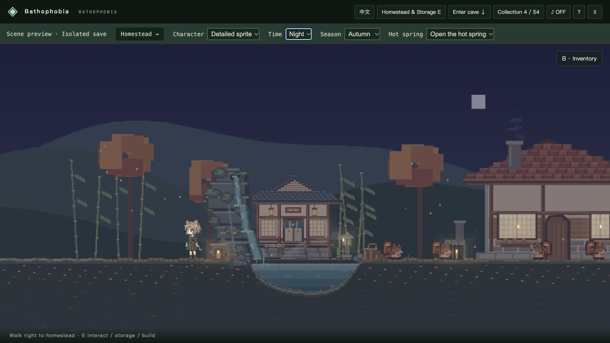
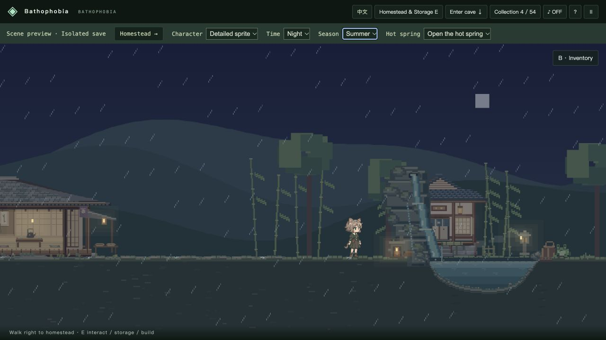
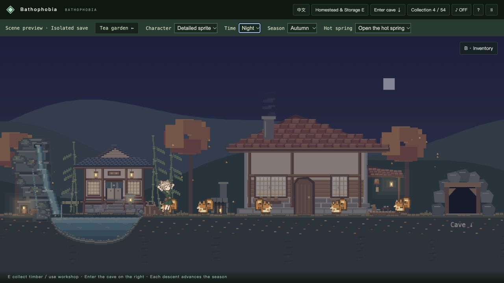
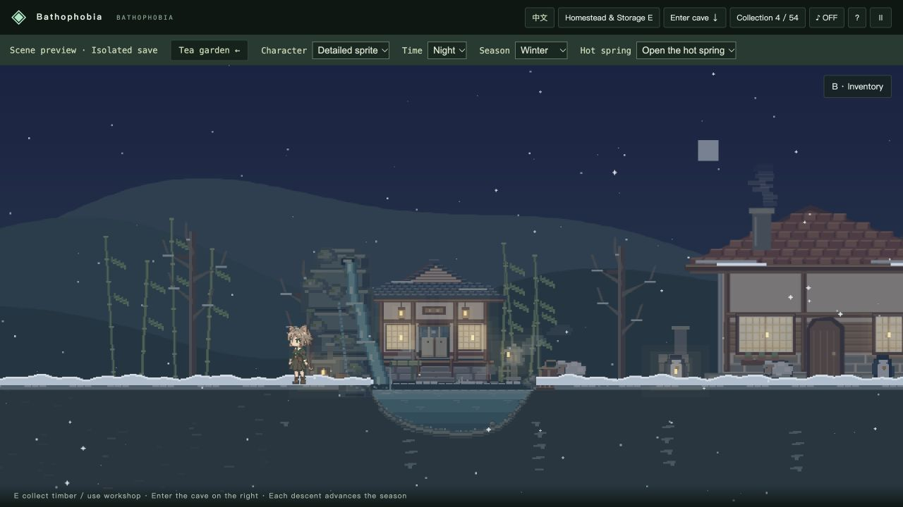
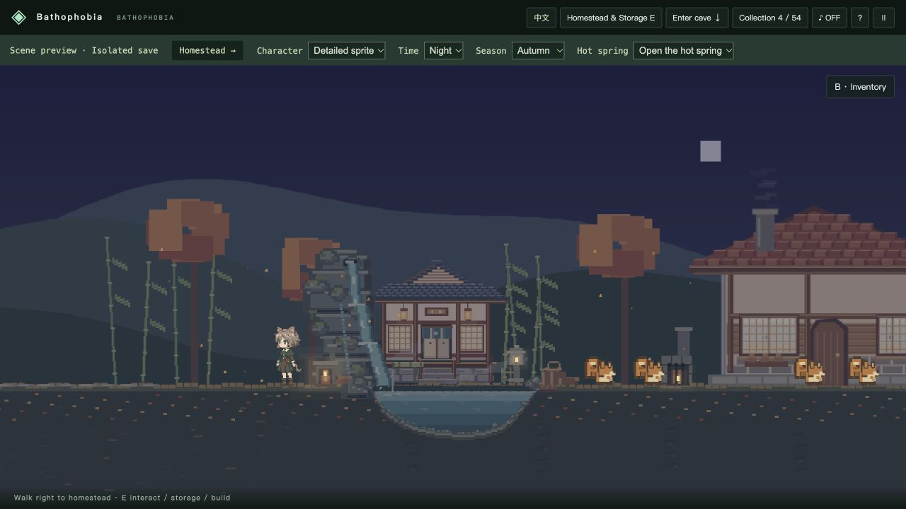

# Surface camera and scene transitions

The tea garden occupies world x −960…0, with the homestead at 0…960. Local physics and interaction coordinates remain unchanged. Crossing the boundary preserves world position. An exponential camera follow (4/s) eases towards the player with bounded scrolling. Distant hills use 0.15/0.28/0.4 scroll factors; the onsen inn and bamboo use 0.82. Buildings, terrain and collision stay at 1.0.

Both room clips are restored before the actor is drawn once in world space. This prevents half-body clipping at the seam, including ears and tails. Ground heights and base colors match at the boundary. The former ground navigation text and wooden sign are removed.

Confirmed cave departure and the return button use the existing 3.6-second pixel edge-in sleep mask. The scene changes once at 1.65 seconds, under full cover; simulation and keys are suspended during the transition. Cancelling the kit selection does not start it.

Reference: Phaser camera follow/lerp and scroll factors: https://docs.phaser.io/phaser/concepts/cameras

Validation: full `npm test`, `npm run build`, browser cave departure/return, and walking through the surface boundary. Regression tests check camera bounds, continuous coordinates, unclipped single actor draw, 0.82× backdrop translation and one-time masked scene switching.

## Shared environment effects

Both regions now use the same seasonal night-tint function and opacity. Summer-night rain and ground splashes, winter snowfall and autumn falling leaves are drawn in the panorama instead of per-region weather passes. Tea-garden ground uses the same autumn leaf litter. The onsen inn's window and lantern lighting is attached to the same 0.82× transform as the inn; pool-edge lighting remains attached to the foreground.

Ground snow accumulation now spans both regions, with a wavy world-anchored surface, thicker at night and excluded from the spring basin. Rain impacts use 180 independently phased emitters; each new event selects a fresh hashed position, duration and splash height rather than a uniform grid. Falling rain ends at ground level.

Inn glow is composited after the night tint using the inn transform. Window glow is restricted to the actual 19×22 and 20×22 inner paper panels, without point-light cores or window halos. The stone lantern and furnace light anchors match their physical flames. Animals are drawn once after the lighting passes; the tea-room and house windows no longer contain invented central lights.

Inn lighting is now drawn within the same background pass as the inn, before all foreground rocks, trees and bamboo. This deliberately supersedes the earlier post-tint emission pass: nearby scenery must fully occlude both lantern cores and window glow. The common night tint still applies consistently. A draw-order regression enforces this relationship.

