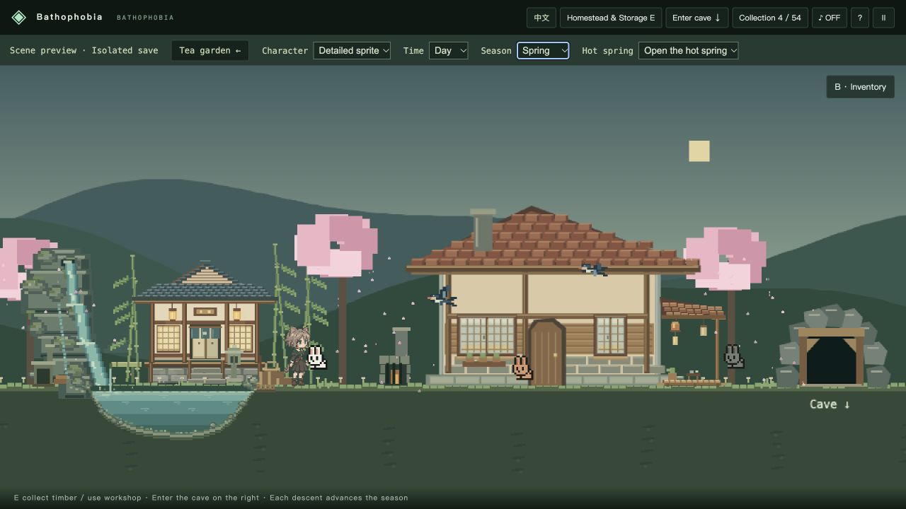
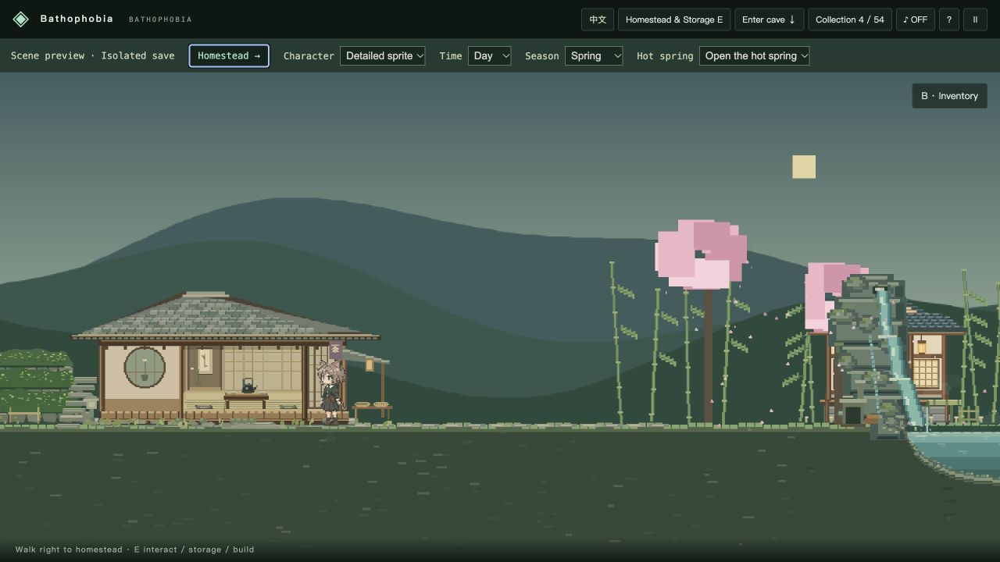

# Shared seasonal vegetation

The homestead and tea garden share `Spring.tree`; spring uses pink blossom shades, summer green foliage, autumn amber foliage, and winter bare snowy branches. Tea-garden bamboo and the onsen backdrop share `Spring.bamboo`, with individually arranged heights and lean values.

Spring-only petals originate around all five tree crowns in world space. Independently hashed lifetimes and phases control drifting, fluttering, pixel-size flips and fading. The effect follows the continuous camera without resetting at the region boundary and avoids the enclosed home interior. Vegetation and petals do not change collision or interactions.

Validation: `npm test`, `npm run build`, actual spring-scene browser inspection in both regions.

