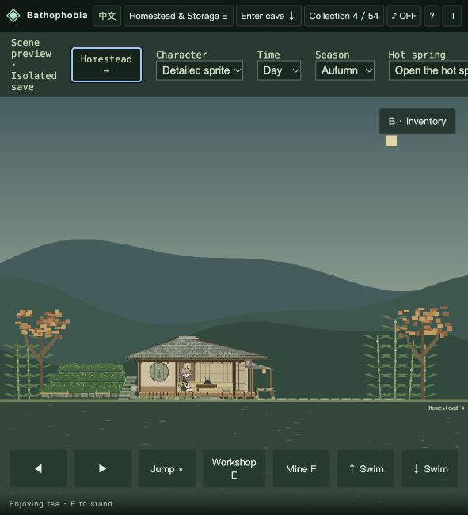

# Tea-room furnishings and ritual

The tea house now has eight ordered construction stages. Stage 7 adds the tea set (4 clay, 2 hematite, 3 quartz, 2 aggregate, 4 gypsum); stage 8 adds the tea table and cushions (6 planks, 4 wool). Existing six-stage saves retain their completed structure and need only the two new furnishings. The full-build preview includes both.

Near the finished entrance, E seats the player in seiza on the left cushion. Movement is suspended while seated; E stands up at the entrance. A sip begins every random 7–10 seconds. Six model-painted full-detail frames show lifting, sipping and lowering the cup; resting uses the cup-on-lap pose so it never disappears after a sip. No cave animation or collision box is changed.

Artwork: built-in imagegen, referenced to the existing home character sheet. Source, packed atlas, metadata and prompt are under `assets/characters/player-detail/tea-*`. The original character atlases are preserved. See `tea-art-prompt.md` for the prompt specification.

Verified with `npm test`, `npm run build`, and actual browser interaction at `/2Afin-admin`.

